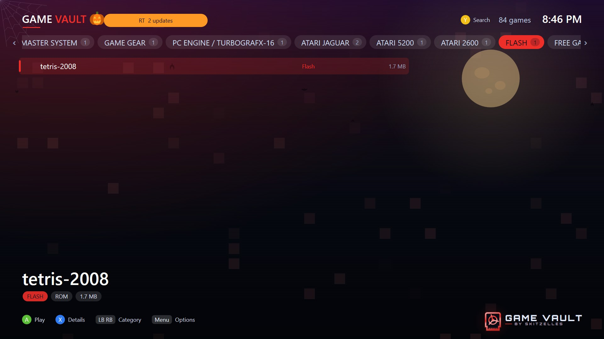

  

<h3 align="center">Game Vault · Flash</h3>

  <b>Flash games on your Xbox, with the controller.</b> 
  The Flash player for <a href="https://github.com/skitzellez/xbox-game-vault">Game Vault</a> on <b>Xbox Series X|S</b> in Dev Mode:
  pick a Flash game in Game Vault and it plays here, then you are back in Game Vault.

  
  &nbsp;
  
  &nbsp;
  

  
  
  
  
  

  

<table align="center">
  <tr>
    <td align="center" width="33%"><h3>🔌 1. Add</h3>Put your <code>.swf</code> games on a USB drive or your PC / NAS.</td>
    <td align="center" width="33%"><h3>🎯 2. Pick</h3>They show up on Game Vault's <b>FLASH</b> shelf.</td>
    <td align="center" width="33%"><h3>▶️ 3. Play</h3>Press A. Flash starts with the game, ready for the controller.</td>
  </tr>
</table>

## ✨ Features

- Plays Flash games (`.swf`) with [Ruffle](https://ruffle.rs), the Flash Player emulator, in the console's own web engine.
- Games from a USB drive or straight from your PC or NAS (Game Vault copies them over, they are small).
- Made for the controller: no keyboard or mouse needed.
- Hold **View + Menu** to go back to Game Vault.

## 🎮 Controls

| Controller | Plays as |
|---|---|
| D-pad / left stick | Arrow keys |
| A | Space |
| B / X / Y | X / Z / C |
| Menu | Enter |
| LB / RB | Shift / Ctrl |
| Right stick | Mouse pointer |
| RT (or LT) | Mouse click |
| Hold View + Menu | Back to Game Vault |

## 📦 Installation

- **Easiest:** in Game Vault press **RT**, pick **Flash** and add it with your phone. Game Vault offers updates there too.
- **By hand:** in Device Portal, **My games & apps → Add**, choose `FlashForGameVault_<version>_x64.appx` from the
  [latest release](https://github.com/skitzellez/Flash-GameVault/releases/latest), then **Start** it once.

Requirements: Xbox Series X|S in Dev Mode with [Game Vault](https://github.com/skitzellez/xbox-game-vault) 0.16.1.297 or newer.

## 🔒 Privacy

Flash games run inside the app, and links a game tries to open are blocked. Game Vault · Flash itself sends nothing anywhere.

## 🔗 Related projects

- [Game Vault](https://github.com/skitzellez/xbox-game-vault): the game library this player belongs to.
- [Game Vault Discord](https://discord.gg/RmhhWgguvw): help, news and reports.

## 🙏 Credits

- [Ruffle](https://ruffle.rs) (MIT / Apache-2.0), the Flash Player emulator: `web/ruffle`, licences in `web/ruffle/LICENSE_MIT` and `web/ruffle/LICENSE_APACHE`.
- [Microsoft WebView2](https://learn.microsoft.com/microsoft-edge/webview2/) (BSD licence, `Microsoft.Web.WebView2.Core.dll`).

No games are included. Play Flash games you are allowed to have.

## 📄 Licence

Game Vault · Flash's own code: [PolyForm Noncommercial 1.0.0](LICENSE), Copyright (c) 2026 Skitzelles: free to use and
share, not for sale, and the notice stays. Ruffle and WebView2 keep their own licences.
